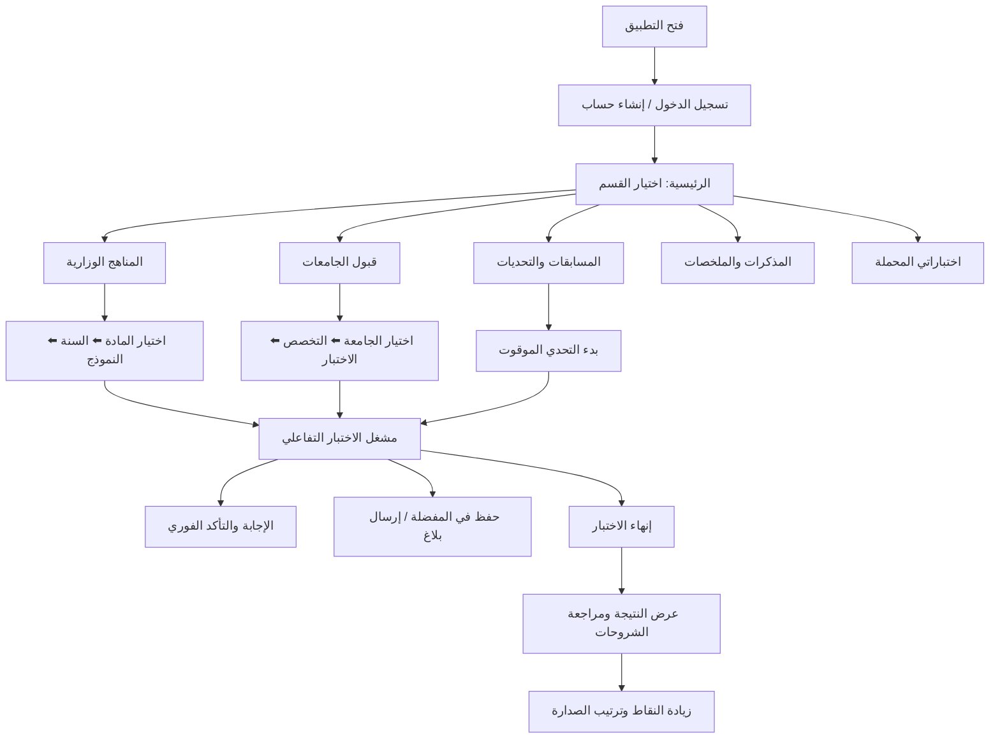

# 📘 وثيقة التوثيق الشاملة لتطبيق «اختبارات اليمن» (ExamYemen)
## Complete Project Documentation & User Guide

---

## 📑 فهرس المحتويات
1. [نظرة عامة وفكرة المشروع (Project Overview & Concept)](#1-نظرة-عامة-وفكرة-المشروع)
2. [الفئات المستهدفة وأهمية التطبيق (Target Audience)](#2-الفئات-المستهدفة-وأهمية-التطبيق)
3. [البنية الهندسية والتقنية (Technical Architecture & Stack)](#3-البنية-الهندسية-والتقنية)
4. [هيكل المشروع وتنظيم الملفات (Project Structure)](#4-هيكل-المشروع-وتنظيم-الملفات)
5. [شرح شامل لجميع أقسام وشاشات التطبيق (Screens & Features)](#5-شرح-شامل-لجميع-أقسام-وشاشات-التطبيق)
   - [أولاً: بوابة الطالب (Student Experience)](#أولاً-بوابة-الطالب-student-experience)
   - [ثانياً: لوحة تحكم الإدارة (Admin Dashboard)](#ثانياً-لوحة-تحكم-الإدارة-admin-dashboard)
6. [دليل الاستخدام الكامل (Comprehensive User Guide)](#6-دليل-الاستخدام-الكامل)
   - [دليل استخدام الطالب (Student Guide)](#دليل-استخدام-الطالب-student-guide)
   - [دليل استخدام مسؤول النظام (Admin Guide)](#دليل-استخدام-مسؤول-النظام-admin-guide)
7. [نماذج البيانات وقواعد البيانات (Data Models & Firestore Schema)](#7-نماذج-البيانات-وقواعد-البيانات)
8. [الميزات المتقدمة والحلول التقنية الذكية (Advanced Features)](#8-الميزات-المتقدمة-والحلول-التقنية-الذكية)
9. [دليل التثبيت والتشغيل والتطوير (Installation & Setup Guide)](#9-دليل-التثبيت-والتشغيل-والتطوير)

---

## 1. نظرة عامة وفكرة المشروع

**تطبيق اختبارات اليمن (ExamYemen)** هو منصة تعليمية وتدريبية رقمية متكاملة مصممة خصيصاً لتلبية احتياجات الطلاب في الجمهورية اليمنية. يهدف التطبيق إلى رقمنة وأتمتة العملية التعليمية وتجهيز الطلاب للاختبارات الوزارية واختبارات القبول الجامعي بأحدث الوسائل التفاعلية.

### 🎯 الرؤية والرسالة:
* **تجاوز تحديات البيئة المحلية**: توفير إمكانية المذاكرة وحل النماذج بدون الحاجة لاتصال مستمر بالإنترنت (Offline First)، لمراعاة ظروف الاتصال والكهرباء في اليمن.
* **المحاكاة الحقيقية لنظام الأتمتة**: تدريب الطالب على أسئلة الاختيار من متعدد (MCQ) والصح والخطأ بنفس أسلوب وتنسيق ورقة الاختبار الوزاري المؤتمت.
* **الشمولية الأكاديمية**: جمع النماذج الوزارية السابقة، مذكرات وملخصات المعلمين المعتمدة، اختبارات القبول لأشهر الجامعات اليمنية، والتحديات التنافسية في منصة واحدة سهلة الاستخدام.

---

## 2. الفئات المستهدفة وأهمية التطبيق

1. **طلاب الشهادة الثانوية (الصف الثالث الثانوي - بقسميه العلمي والأدبي)**:
   - التدرب على مئات النماذج الوزارية المؤتمتة للأعوام السابقة.
   - مراجعة الإجابات النموذجية وفهم طرق الحل والشروحات.
2. **طلاب الشهادة الأساسية (الصف التاسع)**:
   - نماذج مؤتمتة للمرحلة الأساسية في جميع المواد الدراسية.
3. **الطلاب الخريجون والمقبلون على الجامعات**:
   - التدرب على نماذج امتحانات القبول والمفاضلة لكليات الطب، الهندسة، الحاسوب، والعلوم الإدارية في جامعات (صنعاء، عدن، تعز، إب، ذمار، وغيرها).
4. **المعلمون والإداريون**:
   - إضافة وإدارة بنوك الأسئلة، تنظيم المواد، ومتابعة أداء الطلاب وحل استفساراتهم وبلاغاتهم.

---

## 3. البنية الهندسية والتقنية

تم بناء التطبيق وفق معمارية حديثة ونظيفة (Clean & Feature-First Architecture) لضمان القابلية للتوسع والصيانة السهلة:

```
                  ┌─────────────────────────────────┐
                  │       Flutter UI (Presentation)  │
                  └────────────────┬────────────────┘
                                   │
                  ┌────────────────▼────────────────┐
                  │    Riverpod State Providers     │
                  └────────────────┬────────────────┘
                                   │
                  ┌────────────────▼────────────────┐
                  │    Domain Layer & Models        │
                  └────────────────┬────────────────┘
                                   │
         ┌─────────────────────────┴─────────────────────────┐
         ▼                                                   ▼
┌──────────────────┐                               ┌──────────────────┐
│ Cloud Firestore  │                               │ Hive Local Cache │
│ (Remote Database)│                               │ (Offline Engine) │
└──────────────────┘                               └──────────────────┘
```

### 🛠️ الحزمة التقنية المستخدمة (Tech Stack):
* **Flutter & Dart**: لبناء واجهات مستخدم سريعة وعصرية على جميع المنصات.
* **Riverpod**: لإدارة الحالة (State Management) والاعتمادات بكفاءة وأمان.
* **GoRouter**: لإدارة التوجيه والتنقل بين الشاشات بشكل منظم وآمن.
* **Cloud Firestore**: قاعدة البيانات السحابية المركزية وتخزين البيانات لحظياً (Real-time).
* **Firebase Authentication**: مصادقة المستخدمين وإدارة الجلسات والأدوار.
* **Firebase Storage**: تخزين واسترجاع ملفات الـ PDF والصور والوسائط.
* **Firebase Cloud Messaging (FCM)**: نظام الإشعارات والتنبيهات المباشرة.
* **Hive Database**: قاعدة بيانات محلية سريعة جداً لتخزين الاختبارات والمواد بدون إنترنت.
* **Flutter Downloader**: إدارة تنزيل المذكرات والملفات إلى ذاكرة الهاتف.
* **Flutter Math Fork & Custom Engine**: محرك متخصص لمعالجة صيغ الـ LaTeX والرياضيات العربية والرموز العلمية بدون استخدام WebViews البطيئة.

---

## 4. هيكل المشروع وتنظيم الملفات

```
lib/
├── core/                           # الأدوات والثوابت المركزية
│   ├── constants/                  # أسماء الصناديق والثوابت (AppConstants)
│   ├── providers/                  # مزودات الحالة العامة (AppUpdateProvider)
│   ├── services/                   # خدمات Firebase و Hive و التحميل
│   │   ├── firebase_messaging_service.dart
│   │   ├── offline_exam_service.dart
│   │   ├── offline_material_service.dart
│   │   └── storage_service.dart
│   ├── theme/                      # الألوان والتصميم (AppColors, AppTheme)
│   └── utils/                      # التوجيه ومعالجة الأخطاء (AppRouter, ErrorHandler)
│
├── domain/models/                  # نماذج البيانات المنطقية
│   ├── user_model.dart             # بيانات المستخدم والصلاحيات
│   ├── exam_model.dart             # الاختبارات والنماذج الوزارية
│   ├── question_model.dart         # الأسئلة وخيارات الإجابة والمعادلات
│   ├── result_model.dart           # نتائج وإحصائيات الطلاب
│   ├── admission_models.dart       # هيكل قبول الجامعات (جامعة/تخصص/مادة/اختبار)
│   ├── competition_models.dart     # مسابقات وتحديات الفصول والمستويات
│   ├── learning_material_model.dart# المذكرات والملخصات والكتب
│   ├── question_feedback_model.dart# بلاغات واعتراضات الأسئلة
│   ├── bookmark_model.dart         # الأسئلة المحفوظة في المفضلة
│   └── notification_model.dart     # الإشعارات المرسلة
│
├── features/                       # الوحدات البرمجية المعتمدة على الميزات
│   ├── auth/                       # المصادقة (تسجيل الدخول، إنشاء الحساب)
│   ├── student/                    # تجربة الطالب بالكامل
│   │   ├── data/                   # مستودعات جلب بيانات الطلاب
│   │   ├── presentation/           # شاشات وواجهات الطالب (30+ شاشة)
│   │   └── providers/              # حالات النتائج، المفضلة، المسابقات
│   └── admin/                      # لوحة تحكم الإدارة
│       ├── presentation/           # شاشات إدارة المواد، الاختبارات، والمستخدمين
│       ├── providers/              # حالات الإحصائيات والبلاغات
│       └── services/               # عمليات الاستيراد والتصدير السحابي
│
├── firebase_options.dart           # إعدادات تهيئة Firebase الرسمية
└── main.dart                       # نقطة انطلاق التطبيق والتهيئة
```

---

## 5. شرح شامل لجميع أقسام وشاشات التطبيق

---

### أولاً: بوابة الطالب (Student Experience)

#### 1. شاشة الترحيب والتعريف (`OnboardingScreen`)
* **الوظيفة**: جولة تفاعلية سريعة تبرز للطالب أهم ميزات التطبيق (أتمتة وزارية، قبول جامعات، مسابقات، أوفلاين)، وتتيح له البدء فوراً.

#### 2. شاشات الحساب والمصادقة (`LoginScreen` & `RegisterScreen`)
* **الوظيفة**: إنشاء حساب جديد مع تحديد المرحلة الدراسية (ثالث ثانوي علمي/أدبي أو تاسع)، أو تسجيل الدخول بالحساب الحالي. يقوم النظام بتحويل المشرفين تلقائياً إلى لوحة الإدارة والطلاب إلى واجهتهم الخاصة.

#### 3. الواجهة الرئيسية وشريط التنقل السفلي (`MainLayoutScreen`)
* **الوظيفة**: إطار تفاعلي أنيق بتأثير الزجاج (Glassmorphic Bar) يضم 6 أقسام أساسية:
  1. **الرئيسية**: استعراض البوابات الكبرى والإحصائيات.
  2. **الامتحانات**: الدخول المباشر للمناهج الوزارية.
  3. **الصدارة**: ترتيب الأوائل على مستوى الجمهورية.
  4. **مسابقات**: التحديات الموقوتة مع الطلاب الآخرين.
  5. **دراسة**: المذكرات، الكتب، ونماذج الـ PDF.
  6. **حسابي**: الإعدادات والملف الشخصي وسجل الدرجات.

#### 4. لوحة تحكم الطالب (`StudentDashboard`)
* **شريط المستخدم العلوي**: يعرض رصيد النقاط، شارة الإشعارات، وزر الشات السريع.
* **البطاقات الرئيسية**:
  - **المناهج الوزارية**: الانتقال لاختيار المواد والسنوات.
  - **نماذج قبول الجامعات**: الاستعداد للمفاضلة الجامعية.
  - **المسابقات والتحديات**: خوض منافسات موقوتة لكسب النقاط.
  - **المذكرات والملخصات**: فتح مكتبة المواد الرقمية.
  - **اختباراتي المحملة (Offline)**: الوصول للاختبارات بدون شبكة.
* **إحصائيات الإنجاز وسلسلة الالتزام (Streak)**: لتحفيز الطالب على الاستمرار اليومي في الحل.

#### 5. تصفح المواد والسنوات (`SubjectSelectionScreen` & `AcademicYearSelectionScreen`)
* **الوظيفة**: عرض المواد الدراسية الخاصة بصف الطالب مع أيقونات وألوان مميزة، ثم عرض الأعوام المتاحة (مثل: 2024-2025، 2023-2024، نماذج تجريبية).

#### 6. قائمة الاختبارات المتاحة (`AvailableExamsScreen`)
* **الوظيفة**: عرض بطاقات الاختبارات التابعة للمادة والسنة، وتوضيح عدد الأسئلة ومدة الاختبار، مع زر للبدء الفوري أو زر للتحميل والاستخدام أوفلاين.

#### 7. مشغل الاختبار التفاعلي (`ExamPlayerScreen`) — *النواة الأساسية*
* **المميزات**:
  - **عداد الوقت (Timer)**: مؤقت زمني تنازلي محاكي للوقت الفعلي.
  - **محرك الرياضيات (`ArabicMathView`)**: قراءة وعرض المعادلات المعقدة بالرموز العربية واللاتينية بسلاسة.
  - **التأكد الفوري من الحل**: معرفة ما إذا كانت الإجابة صحيحة مع قراءة التفسير والشرح النموذجي فوراً.
  - **شبكة التنقل السريع**: عرض أرقام الأسئلة والقفز لأي سؤال مع تمييز الأسئلة المحلولة.
  - **المفضلة**: حفظ السؤال الصعب بنقرة زر لمراجعته لاحقاً.
  - **زر البلاغ والاعتراض**: إمكانية إرسال اعتراض فوري على أي سؤال للإدارة في حال وجود خطأ مطبعي.
  - **الحفظ التلقائي للتقدم**: الحفاظ على الإجابات في حال تم إغلاق التطبيق بالخطأ.

#### 8. شاشة نتيجة الاختبار ومراجعة الأخطاء (`ExamResultScreen`)
* **الوظيفة**: تفصيل النتيجة النهائية، النسبة المئوية، الدرجة المستحقة، وزر لمراجعة كافة الأسئلة لمعرفة الإجابات الصحيحة وشرح كل سؤال، مع إمكانية إعادة المحاولة.

#### 9. بوابة قبول الجامعات (`Admission...`)
* **الشاشات**: `AdmissionUniversitiesScreen` ⬅️ `AdmissionMajorsScreen` ⬅️ `AdmissionSubjectsScreen` ⬅️ `AdmissionExamsScreen`.
* **الوظيفة**: هيكل شجري يبدأ باختيار الجامعة ثم الكلية ثم المادة ثم خوض اختبارات القبول السابقة.

#### 10. بوابة المسابقات والتحديات (`Competitions...`)
* **الوظيفة**: خوض اختبارات تنافسية موحدة على مستوى الجمهورية بمؤقت زمني دقيق، مع احتساب نقاط ترفع ترتيب الطالب في `CompetitionLeaderboardScreen`.

#### 11. مكتبة المذكرات وعارض الـ PDF (`Materials...` & `PdfViewerScreen`)
* **الوظيفة**: تصفح الملخصات والكتب الدراسية، تشغيل الشروحات المرئية في `VideoPlayerScreen`، وقراءة ملفات الـ PDF بملء الشاشة وتحميلها للهاتف.

#### 12. الاختبارات بدون إنترنت (`OfflineExamsScreen`)
* **الوظيفة**: واجهة خاصة لإدارة وخوض جميع النماذج المحملة مسبقاً في الذاكرة دون الحاجة لأي اتصال بالإنترنت.

#### 13. لوحة الصدارة والشرف (`LeaderboardScreen`)
* **الوظيفة**: تكريم الطلاب المتميزين بعرض أسمائهم ومحافظاتهم ونقاطهم ومراكزهم (الذهبي، الفضي، البرونزي).

#### 14. مركز الدعم، المفضلة، والإشعارات
* **`ContactAdminScreen`**: محادثة شات مباشرة وتفاعلية مع المشرفين لحل المشاكل.
* **`BookmarksScreen`**: مراجعة بنك الأسئلة المميزة بنجمة.
* **`StudentFeedbacksScreen`**: متابعة ردود الإدارة على الاعتراضات التي قدمها الطالب.
* **`StudentNotificationsScreen`**: استقبال الإعلانات والتنبيهات الوزارية والتحديثات.

---

### ثانياً: لوحة تحكم الإدارة (Admin Dashboard)

لوحة سحابية شاملة متجاوبة مع الحواسيب والهواتف (`AdminDashboard`) تمكن المشرفين من إدارة النظام بالكامل:

1. **الإحصائيات السريعة (Dashboard Stats)**: عدد المستخدمين، المواد، الاختبارات، البلاغات المفتوحة، وتحديث تلقائي كل 10 ثوانٍ.
2. **إدارة المواد (`SubjectsView`)**: إضافة وتعديل المواد وتحديد الصف الدراسي ولون وأيقونة المادة.
3. **إدارة السنوات الدراسية (`AcademicYearsView`)**: تنظيم الفترات والأعوام الدراسية.
4. **إدارة الاختبارات والأسئلة (`ExamsView` & `AddQuestionDialog`)**:
   - إنشاء النماذج وضبط المدة ونسبة النجاح.
   - محرر أسئلة متقدم يدعم خيارات متعددة، رفع الصور، كتابة صيغ LaTeX مع معاينة فورية، وكتابة الشرح النموذجي.
   - **الاستيراد والتصدير الجماعي**: رفع مئات الأسئلة دفعة واحدة من ملفات JSON بسرعة وسهولة.
5. **إدارة نماذج الـ PDF الرسمية (`AdminPdfExamsView`)**: رفع وتصنيف النماذج الوزارية المصورة.
6. **إدارة قبول الجامعات (`AdmissionManageView`)**: إضافة الجامعات، الكليات، المواد، ونماذج القبول.
7. **إدارة المسابقات (`CompetitionManageView`)**: جدولة التحديات وضبط أوقاتها ونقاط الفائزين.
8. **إدارة المذكرات والملخصات (`AdminMaterialsView`)**: رفع ملفات الـ PDF، الفيديوهات، والروابط التعليمية.
9. **صندوق معالجة البلاغات (`FeedbacksView`)**: مراجعة اعتراضات الطلاب على الأسئلة وتعديل السؤال مباشرة بنقرة واحدة والرد على الطالب.
10. **الدعم الفني والرسائل (`AdminMessagesView`)**: استقبال والرد على محادثات الطلاب الفورية.
11. **مركز الإشعارات (`NotificationsView`)**: إرسال إشعارات جماعية Push Notifications لجميع الطلاب أو لصف دراسي محدد عبر FCM.
12. **إدارة المستخدمين (`UsersView`)**: مراقبة الطلاب، تعديل الأدوار، ومتابعة سجلات النشاط.
13. **مراقبة النتائج (`ResultsView` & `AdminResultDetailsScreen`)**: فحص نتائج الطلاب وتحليل أداء كل طالب في كل اختبار.
14. **إعدادات النظام والتحديثات (`AppConfigManageScreen`)**: إدارة رقم الإصدار وفرض التحديث الإجباري أو وضع الصيانة.

---

## 6. دليل الاستخدام الكامل

### دليل استخدام الطالب (Student Guide)



1. **بدء المذاكرة وحل النماذج**:
   - افتح تبويب **الامتحانات** أو اختر **المناهج الوزارية** من الرئيسية.
   - اختر المادة (مثال: رياضيات)، ثم اختر العام (مثال: 2024)، ثم اختر النموذج.
   - اضغط **بدء الاختبار**، أو اضغط على أيقونة **التحميل** لحفظه للاستخدام بدون نت.
2. **أثناء خوض الاختبار**:
   - اضغط على الخيار الصحيح.
   - إذا كنت في وضع التدريب، اضغط **تحقق من الإجابة** لمعرفة الحل والشرح مباشرة.
   - لحفظ سؤال مهم للمراجعة، اضغط على أيقونة **النجمة (المفضلة)**.
   - إذا لاحظت خطأ في السؤال، اضغط على أيقونة **البلاغ** واكتب ملاحظتك.
3. **بعد إنهاء الاختبار**:
   - تظهر شاشتك بنتيجتك ونسبتك.
   - اضغط **مراجعة الإجابات** لرؤية كل سؤال أخطأت فيه مع الإجابة الصحيحة وشرحها.
4. **الوصول للمحتوى بدون إنترنت**:
   - انتقل إلى شاشة **اختباراتي المحملة** من الواجهة الرئيسية لتجد كل النماذج التي قمت بتنزيلها جاهزة للحل في أي وقت.

---

### دليل استخدام مسؤول النظام (Admin Guide)

1. **تسجيل الدخول كمسؤول**:
   - سجل الدخول باستخدام بريد المسؤول، وسيتم نقلك تلقائياً إلى لوحة تحكم الإدارة `AdminDashboard`.
2. **إضافة اختبار وأسئلة جديدة**:
   - انتقل إلى قسم **الاختبارات** واضغط **إضافة اختبار جديد**.
   - حدد المادة، السنة، العنوان، ومدة الاختبار.
   - افتح الاختبار واضغط **إضافة سؤال**:
     - أدخل نص السؤال.
     - لدعم الرياضيات استخدم رموز LaTeX مثل `$x^2 + \sqrt{y}$`.
     - حدد الخيارات الأربعة وعيّن الخيار الصحيح.
     - أضف التفسير والشرح وأرفق صورة إن وجدت، ثم اضغط **حفظ**.
3. **الاستيراد السريع للأسئلة (Bulk Import)**:
   - في شاشة الاختبار، اضغط على خيار **استيراد JSON** وارفع ملف الأسئلة ليتم إدراجها فورياً.
4. **الرد على استفسارات وبلاغات الطلاب**:
   - توجه لتبويب **البلاغات** لمشاهدة الملاحظات المرسلة على الأسئلة وتصحيح السؤال مباشرة بنقرة زر.
   - توجه لتبويب **الرسائل** للرد على محادثات الدعم الفني.
5. **إرسال إشعار عام للطلاب**:
   - ادخل على تبويب **الإشعارات**، اكتب عنوان الإشعار ونصه، واختر الفئة المستهدفة، ثم اضغط **إرسال** لتصل لجميع الهواتف عبر FCM.

---

## 7. نماذج البيانات وقواعد البيانات (Data Models)

### جدول ملخص الكيانات الأساسية (Firestore Collections)

| المجموعة (Collection) | الوصف والحقول الرئيسية |
| :--- | :--- |
| **`users`** | `id`, `name`, `email`, `role`, `grade`, `stream`, `points`, `solvedExamsCount`, `createdAt` |
| **`subjects`** | `id`, `name`, `grade`, `stream`, `iconName`, `colorHex`, `order` |
| **`exams`** | `id`, `title`, `subjectId`, `gradeId`, `academicYear`, `timeLimit`, `totalQuestions`, `isPdf`, `pdfUrl` |
| **`questions`** | `id`, `examId`, `text`, `options`, `correctAnswerIndex`, `explanation`, `imageUrl`, `mathFormula` |
| **`results`** | `id`, `userId`, `examId`, `score`, `totalQuestions`, `percentage`, `answersMap`, `timeTakenSeconds`, `completedAt` |
| **`admission_universities`** | `id`, `name`, `logoUrl`, `description`, `city` |
| **`admission_majors`** | `id`, `universityId`, `name`, `faculty` |
| **`competitions`** | `id`, `title`, `semesterId`, `subjectId`, `timerMinutes`, `rewardPoints`, `startDate`, `endDate` |
| **`learning_materials`** | `id`, `subjectId`, `title`, `description`, `type (pdf/video/link)`, `fileUrl`, `fileSize` |
| **`question_feedbacks`** | `id`, `questionId`, `examId`, `userId`, `feedbackText`, `status`, `adminReply`, `createdAt` |
| **`messages`** | `id`, `userId`, `userName`, `message`, `isFromAdmin`, `timestamp`, `isRead` |

---

## 8. الميزات المتقدمة والحلول التقنية الذكية

1. **نظام الأوفلاين الشامل (Offline-First Architecture)**:
   - استخدام Hive لتخزين كائنات الأسئلة والاختبارات كملفات ثنائية سريعة القراءة.
   - استخدام Firestore Persistence لتخزين ومزامنة البيانات في الخلفية.
2. **محرك الرياضيات العربية المخصص (`ArabicMathView`)**:
   - حل مشكلة انعكاس الحروف والاتجاهات الشائعة في نصوص الـ LaTeX العربية باستخدام تقنيات فصل المقاطع وتطبيق الاتجاه المعاكس على نصوص `\text{}` داخل معادلات الـ LTR.
3. **نظام المكافآت وسلسلة الالتزام (Gamification Engine)**:
   - نقاط تلقائية عند إكمال الاختبارات بنجاح ترفع رتبة الطالب في لوحة الصدارة وتزيد من تفاعله اليومي.
4. **التحديثات والإدارة الحية الفورية (Live Admin Controls)**:
   - إمكانية تفعيل وضع الصيانة، أو فرض التحديث الإجباري للتطبيق عن بعد من خلال شاشة `AppConfigManageScreen`.

---

## 9. دليل التثبيت والتشغيل والتطوير

### المتطلبات الأساسية (Prerequisites):
* **Flutter SDK**: الإصدار 3.24+ أو أحدث.
* **Dart SDK**: متوافق مع إصدار Flutter.
* **Android Studio / VS Code**: مع إضافات Flutter & Dart.
* **Firebase Project**: مشروع Firebase مهيأ (Firestore, Auth, Storage, FCM).

### خطوات التشغيل محلياً (Run Steps):

1. **استنساخ المشروع وتثبيت الحزم**:
   ```bash
   git clone <REPO_URL>
   cd ExamYemen
   flutter pub get
   ```

2. **تهيئة إعدادات Firebase**:
   - تأكد من وجود ملف `lib/firebase_options.dart` وملف `google-services.json` داخل `android/app/`.

3. **تشغيل التطبيق**:
   ```bash
   # للتشغيل على جهاز أندرويد أو محاكي
   flutter run

   # للتشغيل على متصفح الويب (لوحة الإدارة)
   flutter run -d chrome
   ```

4. **بناء النسخة الإنتاجية (Build APK / AppBundle)**:
   ```bash
   flutter build apk --release
   # أو
   flutter build appbundle --release
   ```

---

## 🏁 الخلاصة
يمثل مشروع **اختبارات اليمن (ExamYemen)** نقلة نوعية في أتمتة التعليم والتدريب للطلاب اليمنيين، حيث يجمع بين **الأداء الفائق، التصميم الاحترافي، والعمل بدون إنترنت** لتقديم أفضل تجربة دراسية ممكنة ومساعدة الطلاب على التفوق والنجاح في امتحاناتهم المصيرية.
